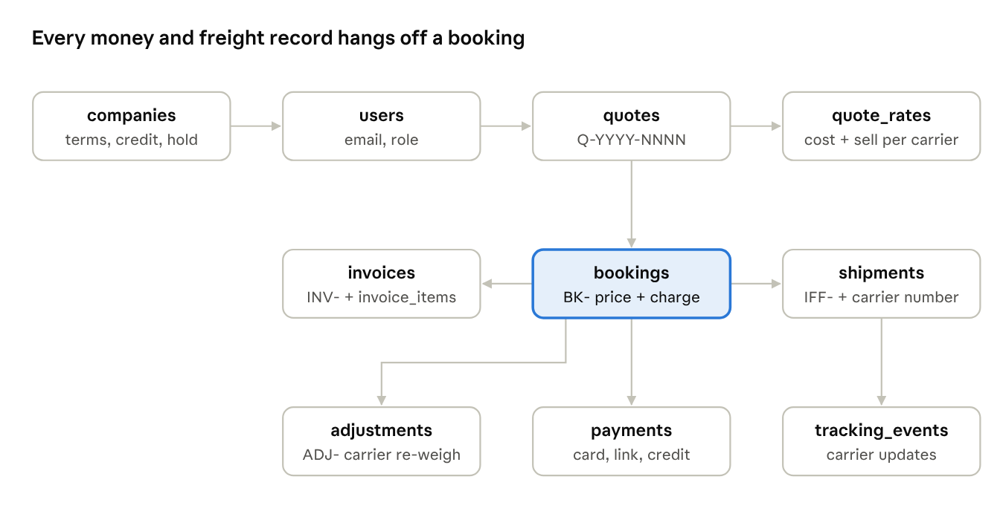

# IFF Cargo Portal — SQL Data Map

Nov 23, 2026 · @Hossein Dabiri

## How to use this

The portal's data fits in 25 SQL tables. Each one lines up with your internal database through the business numbers IFF already uses: booking BK-, quote Q-, tracking IFF-, invoice INV- and adjustment ADJ-. The portal itself runs on MongoDB. The tables below are the same records written as SQL, so they can be exported or synced into your database. Monthly statements are not included because IFF produces them in its own system.

- **Primary keys:** every row has an `id`, the portal's internal record id (24 hex characters). Keep it as the sync key and use the business numbers to match people-facing records.
- **Money:** `DECIMAL(12,2)`. A carrier price stays in the carrier's currency, which is CAD or USD (`currency`). The customer's charge is in the currency they chose (`charge_currency`), converted at the USD→CAD rate locked when they booked (`fx_rate`).
- **Dates:** timestamps are UTC. Pickup date and times are local to the pickup address (`YYYY-MM-DD`, `HH:MM`).
- **Units:** weight in lb and dimensions in inches, except where a column says kg or cm.
- **Lists:** lists kept inside one portal record, such as invoice lines and LTL line items, become child tables (for example `invoice_items`).
- **Left out:** login codes, the QuickBooks connection token, FedEx account connections and the unused saved-cards table. They hold security data or nothing to reconcile.

The SQL is standard and runs on PostgreSQL as written. For SQL Server, change `TIMESTAMP` to `DATETIME2`, `BOOLEAN` to `BIT` and `TEXT` to `NVARCHAR(MAX)`.

## Matching keys

Match records on these numbers. Each is unique and never reused, and a new one is the highest existing number plus one. The year in each prefix is the year the record was created.

| Number | Example | Table.column | What it identifies | Also stored on |
| --- | --- | --- | --- | --- |
| Quote | Q-2026-0142 | quotes.quote\_number | One rate request and its carrier options | bookings (via quote\_id) |
| Booking | BK-2026-0066 | bookings.booking\_number | The sale: chosen carrier, price, payment | — |
| IFF tracking | IFF-2026-00058 | shipments.tracking\_number | The physical shipment in the portal | claims.tracking\_number |
| Carrier tracking / PRO | 794860006524 | shipments.carrier\_tracking\_number | The carrier's own number (FedEx, XPO PRO, DHL waybill) | claims.tracking\_number (sometimes) |
| Carrier order / BOL | C1472122 | shipments.carrier\_confirmation\_number | Carrier order id or BOL number when it differs from tracking | — |
| Pickup confirmation | carrier's format | bookings.pickup\_confirmation\_number | Carrier pickup request number | — |
| Invoice | INV-2026-0031 | invoices.invoice\_number | One booking's invoice, or one adjustment's | — |
| Adjustment | ADJ-2026-0002 | adjustments.adjustment\_number | Price correction after the carrier re-weighs or re-classes | — |
| Spot rate request | SPR-2026-0009 | spot\_rate\_requests.request\_number | FTL, air or ocean request priced by IFF staff | links to the quote it created |
| Guest quote request | GQR-2026-0004 | guest\_quote\_requests.request\_number | Request from a visitor without an account | — |
| Claim | CLM-2026-0003 | claims.claim\_number | Cargo claim | — |
| QuickBooks customer | QuickBooks id | companies.qb\_customer\_id | The company's customer record in QuickBooks Online | — |
| QuickBooks invoice | 1043 | bookings.qb\_invoice\_id | Invoice behind a "pay by QuickBooks link" booking | — |
| QuickBooks charge | QuickBooks charge id | payments.qb\_transaction\_id | Card charge or refund in QuickBooks Payments | adjustments.qb\_transaction\_id |

Companies and users have no business number. Match them on `companies.name` plus `postal_code`, or `users.email`. Alternatively, store the portal `id` in your customer table.

## How the tables connect



A booking is the hub. Start from the booking number to find its quote and carrier rate, its shipment and tracking, and every payment, invoice and adjustment. Not drawn: addresses and claims link to companies and shipments; spot and guest requests feed quotes.

## Customers

A **company** is the account: payment terms, credit limit and store credit sit here. Each **user** belongs to one company, and **addresses** are the company's shared address book.

### companies

| Column | Type | Data point |
| --- | --- | --- |
| id | CHAR(24) PK | Portal record id |
| name | VARCHAR(200) | Company name |
| street, city, province, postal\_code, country | VARCHAR | Head-office address (country = ISO code, CA / US) |
| phone | VARCHAR(40) | Main phone |
| tax\_number | VARCHAR(40) | GST/HST or tax id |
| shipping\_type | VARCHAR(40) | What they mostly ship (from registration) |
| payment\_terms | VARCHAR(10) | card or monthly |
| credit\_limit\_cad | DECIMAL(12,2) | Monthly accounts: most they can owe, in CAD (USD bookings count at the USD→CAD rate) |
| credit\_cad, credit\_usd | DECIMAL(12,2) | Store credit available, used automatically at booking |
| account\_hold\_active | BOOLEAN | True = no new bookings until overdue balances are paid |
| account\_hold\_reason, account\_hold\_since | VARCHAR / TIMESTAMP | Why and since when |
| qb\_customer\_id | VARCHAR(40) | QuickBooks Online customer id |
| is\_active | BOOLEAN | Account enabled |
| created\_at, updated\_at | TIMESTAMP |  |

### users

| Column | Type | Data point |
| --- | --- | --- |
| id | CHAR(24) PK | Portal record id |
| company\_id | CHAR(24) FK → companies | Their company |
| email | VARCHAR(200) UNIQUE | Login and contact email |
| first\_name, last\_name, phone | VARCHAR |  |
| role | VARCHAR(20) | customer, company\_admin, iff\_staff, iff\_admin |
| terms\_accepted\_at, terms\_accepted\_ip | TIMESTAMP / VARCHAR | IFF terms acceptance |
| fedex\_terms\_accepted\_at, fedex\_terms\_accepted\_ip | TIMESTAMP / VARCHAR | FedEx end-user terms acceptance |
| notify\_shipment\_booked … notify\_promotional | BOOLEAN (7 columns) | Email preferences: booked, out for delivery, delivered, exceptions, spot rates, claims, promotional |
| created\_at, updated\_at | TIMESTAMP |  |

Password hashes are not exported.

### addresses

| Column | Type | Data point |
| --- | --- | --- |
| id | CHAR(24) PK |  |
| company\_id | CHAR(24) FK → companies | Owner of the address book |
| created\_by\_user\_id | CHAR(24) FK → users |  |
| contact\_name, company\_name, phone | VARCHAR | Contact at the address |
| street, city, province, postal\_code, country | VARCHAR |  |
| is\_residential, is\_verified | BOOLEAN |  |
| created\_at, updated\_at | TIMESTAMP |  |

## Quoting

A **quote** is one rate request; it gets one **quote\_rates** row per carrier service returned. FTL, air and ocean go through a **spot rate request** that IFF staff price by hand, which then creates a normal quote. Visitors without an account leave a **guest quote request**.

### quotes

| Column | Type | Data point |
| --- | --- | --- |
| id | CHAR(24) PK |  |
| quote\_number | VARCHAR(20) UNIQUE | Q-YYYY-NNNN |
| user\_id | CHAR(24) FK → users | Who asked |
| shipment\_type | VARCHAR(20) | envelope, parcel, ltl, ftl, air, ocean |
| origin\_city, origin\_province, origin\_postal, origin\_country | VARCHAR | Origin |
| dest\_city, dest\_province, dest\_postal, dest\_country | VARCHAR | Destination |
| weight\_lb | DECIMAL(10,2) | Total weight |
| pieces | INT |  |
| dim\_l\_in, dim\_w\_in, dim\_h\_in | DECIMAL(8,2) | Parcel dimensions |
| freight\_class | VARCHAR(10) | LTL freight class |
| currency | CHAR(3) | Currency shown when quoted |
| pickup\_date | DATE |  |
| pickup\_ready\_time, pickup\_close\_time | CHAR(5) | HH:MM window, 08:00–17:00, at least 3 hours |
| declared\_value | DECIMAL(12,2) |  |
| commodity | VARCHAR(200) |  |
| accessorials | VARCHAR(500) | Comma-separated option codes (liftgate, residential, pickup …) |
| opt\_fedex\_packaging, opt\_fedex\_one\_rate, opt\_dg\_type, opt\_battery\_material, opt\_battery\_packing, opt\_home\_delivery\_date, opt\_limited\_access\_type | VARCHAR / BOOLEAN | Option details chosen with the accessorials |
| status | VARCHAR(20) | active, booked, expired |
| expires\_at, created\_at | TIMESTAMP |  |

**quote\_line\_items** (LTL, one row per group of identical pieces): id, quote\_id FK, line\_no, pieces, length\_in, width\_in, height\_in, weight\_lb (per piece), freight\_class.

### quote\_rates

| Column | Type | Data point |
| --- | --- | --- |
| id | CHAR(24) PK |  |
| quote\_id | CHAR(24) FK → quotes |  |
| carrier\_id | VARCHAR(20) | fedex, xpo, dayross, manitoulin, polaris, dhl, csa, estes, or iff for spot rates priced by IFF |
| carrier\_name, service\_name, service\_code | VARCHAR | e.g. FedEx / Express Saver / FEDEX\_EXPRESS\_SAVER |
| currency | CHAR(3) | Carrier's currency for the three amounts below |
| base\_rate | DECIMAL(12,2) | **Carrier cost** |
| engine\_rate | DECIMAL(12,2) | Price the pricing engine produced |
| display\_rate | DECIMAL(12,2) | **Sell price** shown and booked (after any IFF override) |
| transit\_days, estimated\_delivery | INT / DATE |  |
| is\_live\_rate, is\_best\_rate | BOOLEAN | Live carrier API rate; cheapest option |
| rules\_version | INT FK → pricing\_rule\_sets.version | Pricing rules used |
| markup\_pct, gross\_margin | DECIMAL | Snapshot of the pricing result |
| cost\_cad, sell\_cad, fx\_rate | DECIMAL | Cost and sell in CAD; USD→CAD rate used |
| chargeable\_wt\_lb, density\_pcf, est\_class, dim\_governs | DECIMAL / BOOLEAN | Weight and density used for pricing |
| flags | VARCHAR(500) | Pricing flags, comma-separated |
| not\_included\_options, not\_included\_message | VARCHAR | Options this carrier couldn't price |
| adjusted\_by\_user\_id, adjusted\_at, adjustment\_reason, adjustment\_note |  | IFF price override before booking (discount, competitive, contract, oneoff, correction, other) |

**quote\_rate\_accessorials** (carrier's charge per option, already inside base\_rate): id, quote\_rate\_id FK, code (can be empty), label, amount.

### spot\_rate\_requests

| Column | Type | Data point |
| --- | --- | --- |
| id | CHAR(24) PK |  |
| request\_number | VARCHAR(20) UNIQUE | SPR-YYYY-NNNN |
| user\_id | CHAR(24) FK → users |  |
| shipment\_type | VARCHAR(20) | ftl, air, ocean |
| air\_service | VARCHAR(10) | pickup or dropoff |
| origin\_street, origin\_city, origin\_province, origin\_postal, origin\_country | VARCHAR |  |
| dest\_city, dest\_province, dest\_postal, dest\_country | VARCHAR |  |
| origin\_port, dest\_port, ocean\_type | VARCHAR | Ocean |
| weight, weight\_unit | DECIMAL / CHAR(2) | lb or kg |
| pieces, skids, dimensions | INT / VARCHAR(200) | dimensions = free text on older requests |
| volume\_weight\_kg, chargeable\_weight\_kg | DECIMAL | Air / ocean LCL |
| pickup\_date, commodity, declared\_value, special\_notes |  |  |
| status | VARCHAR(10) | pending, quoted, declined, booked |
| quoted\_rate, quoted\_currency | DECIMAL / CHAR(3) | **Sell price** IFF gave |
| carrier\_cost, carrier\_name, service\_name, transit\_days |  | **Cost** and carrier IFF will use (internal) |
| valid\_until, quoted\_at, quoted\_by\_user\_id, declined\_at |  |  |
| customer\_note, staff\_note | TEXT |  |
| quote\_id, quote\_rate\_id | CHAR(24) FK | The quote created when priced (booked like any other) |
| submitted\_at, updated\_at | TIMESTAMP |  |

**spot\_rate\_packages**: id, request\_id FK, pieces, length, width, height, unit (cm/in), volume\_weight\_kg.

### guest\_quote\_requests

| Column | Type | Data point |
| --- | --- | --- |
| id | CHAR(24) PK |  |
| request\_number | VARCHAR(20) UNIQUE | GQR-YYYY-NNNN |
| name, company, email, phone | VARCHAR | The visitor |
| origin, origin\_type, destination, destination\_type | VARCHAR | Free text; door or terminal |
| mode, volume | VARCHAR | air / ocean / land; lcl / fcl / ltl / ftl |
| terms\_of\_sale | VARCHAR(10) | exw, fob, cif, cfr, dap, ddp, other, unknown |
| hazardous | BOOLEAN |  |
| notes, source | TEXT / VARCHAR |  |
| status | VARCHAR(10) | new, contacted, quoted, declined, closed |
| quoted\_rate, quoted\_currency, carrier\_cost, carrier\_name, service\_name, transit\_days, valid\_until |  | Price sent and internal cost |
| customer\_note, staff\_note, quoted\_at, quoted\_by\_user\_id, declined\_at, handled\_by\_user\_id, handled\_at |  |  |
| submitted\_at, updated\_at | TIMESTAMP |  |

**guest\_quote\_items**: id, request\_id FK, quantity, length, width, height, dim\_unit, weight (per item), weight\_unit.

## Bookings and shipments

Each booked quote makes one **booking**, the sale and its money, and one **shipment**, the freight and its carrier numbers. Carrier tracking updates go to **tracking\_events**.

### bookings

| Column | Type | Data point |
| --- | --- | --- |
| id | CHAR(24) PK |  |
| booking\_number | VARCHAR(20) UNIQUE | BK-YYYY-NNNN |
| quote\_id | CHAR(24) FK → quotes, UNIQUE | One booking per quote |
| quote\_rate\_id | CHAR(24) FK → quote\_rates | The carrier option chosen |
| user\_id, company\_id | CHAR(24) FK | Who booked; their company at booking time |
| carrier\_id, carrier\_name, service\_name | VARCHAR |  |
| currency | CHAR(3) | Carrier's currency for the two amounts below |
| cost\_rate | DECIMAL(12,2) | **Carrier cost**, frozen at booking |
| sell\_rate | DECIMAL(12,2) | **Sell price** in the carrier's currency (current, after overrides) |
| original\_sell\_rate | DECIMAL(12,2) | Sell price at booking, if IFF later overrode it |
| balance\_adjustment | DECIMAL(12,2) | Still owed after an override: + collect, − refund |
| charge\_currency | CHAR(3) | Currency the customer paid in (CAD or USD) |
| charge\_amount | DECIMAL(12,2) | **What the customer paid**, in charge\_currency |
| fx\_rate | DECIMAL(8,4) | USD→CAD rate used for the conversion |
| payment\_method | VARCHAR(10) | card, qb\_link, account (monthly), credit |
| payment\_status | VARCHAR(20) | paid, invoiced, awaiting\_payment, not\_required, cancelled |
| status | VARCHAR(20) | confirmed, awaiting\_payment, cancelled |
| qb\_invoice\_id, qb\_invoice\_link | VARCHAR | QuickBooks invoice for "pay by link" |
| pay\_by | TIMESTAMP | Link bookings: cancelled if unpaid by then (24 h) |
| customer\_reference | VARCHAR(100) | Customer's PO or reference |
| pickup\_confirmation\_number | VARCHAR(60) | Carrier pickup number |
| pickup\_confirmed\_at, measurements\_confirmed\_at, cancelled\_at | TIMESTAMP |  |
| booked\_at, updated\_at | TIMESTAMP |  |

**booking\_price\_overrides** (IFF changes to the price after booking): id, booking\_id FK, from\_amount, to\_amount, reason, note, by\_user\_id, at.

### shipments

| Column | Type | Data point |
| --- | --- | --- |
| id | CHAR(24) PK |  |
| tracking\_number | VARCHAR(20) UNIQUE | IFF-YYYY-NNNNN |
| carrier\_tracking\_number | VARCHAR(60) | Carrier tracking, PRO or waybill |
| carrier\_confirmation\_number | VARCHAR(60) | Carrier order or BOL id |
| booking\_id | CHAR(24) FK → bookings, UNIQUE |  |
| user\_id, company\_id | CHAR(24) FK |  |
| carrier\_id, carrier\_name, service\_name, shipment\_type | VARCHAR |  |
| shipper\_name, shipper\_company, shipper\_phone | VARCHAR | Pickup contact |
| origin\_street\_1, origin\_street\_2, origin\_city, origin\_province, origin\_postal, origin\_country | VARCHAR | Pickup address |
| recipient\_name, recipient\_company, recipient\_phone, recipient\_email | VARCHAR | Delivery contact |
| dest\_street\_1, dest\_street\_2, dest\_city, dest\_province, dest\_postal, dest\_country | VARCHAR | Delivery address |
| weight\_lb, pieces, dim\_l\_in, dim\_w\_in, dim\_h\_in, freight\_class |  | As booked |
| currency, declared\_value, commodity, accessorials |  |  |
| hold\_location\_id, hold\_location\_name, hold\_location\_type, hold\_location\_address | VARCHAR | FedEx Hold at Location (address as JSON) |
| customs\_description, customs\_hs\_code, customs\_country\_of\_manufacture | VARCHAR(70) / VARCHAR(10) / CHAR(2) | International parcels: what was declared to customs (shipments booked from Nov 23, 2026) |
| dg\_un\_number, dg\_proper\_name, dg\_class, dg\_packing\_group, dg\_quantity, dg\_units, dg\_emergency\_phone |  | Dangerous goods |
| manual\_booking\_required, manual\_booking\_reason | BOOLEAN / VARCHAR | IFF must finish the carrier booking |
| status | VARCHAR(20) | pending, in\_transit, delivered, cancelled |
| pickup\_status | VARCHAR(20) | scheduled (carrier confirmed) or to\_arrange (IFF books it) |
| estimated\_delivery, actual\_delivery | DATE |  |
| last\_tracked\_at, booked\_at, updated\_at | TIMESTAMP |  |

The label PDF is not exported; it stays in the portal.

### tracking\_events

| Column | Type | Data point |
| --- | --- | --- |
| id | CHAR(24) PK |  |
| shipment\_id | CHAR(24) FK → shipments |  |
| event | VARCHAR(100) | e.g. Picked up, In transit, Delivered |
| location | VARCHAR(200) |  |
| event\_time | TIMESTAMP | When it happened |
| description | TEXT |  |
| created\_at | TIMESTAMP | When the portal recorded it |

## Money

Every money movement is a **payments** row: a card charge, a QuickBooks link payment, store credit used, or a refund (negative). Each booking gets one **invoice**. **Adjustments** record a carrier's re-weigh or re-class and what the customer owes or gets back.

### payments

| Column | Type | Data point |
| --- | --- | --- |
| id | CHAR(24) PK |  |
| booking\_id | CHAR(24) FK → bookings |  |
| user\_id | CHAR(24) FK → users | Who paid |
| amount | DECIMAL(12,2) | Negative for refunds |
| currency | CHAR(3) |  |
| method | VARCHAR(10) | card, qb\_link, credit, offline |
| status | VARCHAR(10) | pending, succeeded, failed, refunded |
| qb\_transaction\_id | VARCHAR(60) | QuickBooks charge, refund or invoice id; "store-credit" when paid from credit |
| failure\_reason | VARCHAR(500) | Card decline reason |
| attempted\_at | TIMESTAMP |  |

### invoices

| Column | Type | Data point |
| --- | --- | --- |
| id | CHAR(24) PK |  |
| invoice\_number | VARCHAR(20) UNIQUE | INV-YYYY-NNNN |
| company\_id, user\_id | CHAR(24) FK | Billed company; who triggered it |
| total\_amount | DECIMAL(12,2) | In the customer's charge currency |
| currency | CHAR(3) |  |
| status | VARCHAR(10) | pending, paid |
| due\_date, paid\_at, issued\_at | TIMESTAMP |  |

**invoice\_items**: id, invoice\_id FK, line\_no, booking\_id FK, shipment\_id FK, description, amount.

### adjustments

| Column | Type | Data point |
| --- | --- | --- |
| id | CHAR(24) PK |  |
| adjustment\_number | VARCHAR(20) UNIQUE | ADJ-YYYY-NNNN |
| booking\_id, shipment\_id, company\_id, user\_id | CHAR(24) FK |  |
| currency | CHAR(3) | Customer's charge currency |
| reason | VARCHAR(20) | weight, dimensions, freight\_class, accessorial, other |
| entered\_weight\_lb, entered\_pieces, entered\_l\_in, entered\_w\_in, entered\_h\_in, entered\_class |  | What the customer entered |
| measured\_weight\_lb, measured\_pieces, measured\_l\_in, measured\_w\_in, measured\_h\_in, measured\_class |  | What the carrier found |
| carrier\_reference | VARCHAR(100) | Carrier invoice or reweigh certificate number |
| evidence\_note | TEXT |  |
| original\_cost, new\_cost | DECIMAL(12,2) | **Carrier cost** before and after |
| original\_price, new\_price | DECIMAL(12,2) | **Sell price** before and after (same rules version) |
| difference | DECIMAL(12,2) | new\_price − original\_price |
| admin\_fee | DECIMAL(12,2) | Fee per charged adjustment |
| amount\_due | DECIMAL(12,2) | Customer pays this (0 if absorbed or credited) |
| credit\_amount | DECIMAL(12,2) | Returned to the customer on an undercharge |
| rules\_version | INT |  |
| outcome | VARCHAR(10) | charge, absorbed (C$10 or less), credit, refund |
| status | VARCHAR(20) | draft, sent, paid, disputed, waived, absorbed, credited, refunded, cancelled |
| due\_date | TIMESTAMP | Sent + 14 days; the account goes on hold after it |
| sent\_at, paid\_at | TIMESTAMP |  |
| paid\_with\_credit | DECIMAL(12,2) | Part paid from store credit |
| qb\_transaction\_id | VARCHAR(60) | Card charge or refund |
| dispute\_reason, disputed\_at, resolution\_note, staff\_note |  |  |
| created\_by\_user\_id, handled\_by\_user\_id | CHAR(24) FK → users | IFF staff |
| created\_at, updated\_at | TIMESTAMP |  |

Store credit balances live on `companies.credit_cad` and `credit_usd`. A charged adjustment on a monthly account also creates an invoice.

## Claims, carriers and pricing

### claims

| Column | Type | Data point |
| --- | --- | --- |
| id | CHAR(24) PK |  |
| claim\_number | VARCHAR(20) UNIQUE | CLM-YYYY-NNNN |
| user\_id | CHAR(24) FK → users |  |
| shipment\_id | CHAR(24) FK → shipments | When matched to a portal shipment |
| tracking\_number | VARCHAR(60) | As the customer entered it (IFF or carrier number) |
| carrier\_id, carrier\_name | VARCHAR |  |
| claim\_type | VARCHAR(30) | Free text, e.g. Damage, Lost package, Delay, Other (older records: Damaged goods, Lost shipment, Shortage) |
| shipment\_date | DATE |  |
| amount\_claimed, currency | DECIMAL / CHAR(3) |  |
| commodity, description, additional\_notes, documents | TEXT |  |
| status | VARCHAR(20) | open, under\_review, approved, closed |
| submitted\_at, updated\_at | TIMESTAMP |  |

**claim\_documents**: id, claim\_id FK, uploaded\_by\_user\_id, document\_type (photo, invoice, packing\_list, inspection\_report), file\_name, mime\_type, file\_size\_bytes, storage\_key, uploaded\_at.

### carriers

| Column | Type | Data point |
| --- | --- | --- |
| carrier\_id | VARCHAR(20) PK | fedex, xpo, dayross, manitoulin, polaris, dhl, csa, estes |
| name | VARCHAR(100) |  |
| enabled, provides\_live\_rates | BOOLEAN |  |
| shipment\_types | VARCHAR(100) | envelope, parcel, ltl (comma-separated) |
| lanes | VARCHAR(100) | domestic\_ca, domestic\_us, cross\_border, international |
| created\_at, updated\_at | TIMESTAMP |  |

### pricing\_rule\_sets

One row per published version of the markup rules. Every quote\_rates row stores the version that priced it.

| Column | Type | Data point |
| --- | --- | --- |
| version | INT PK |  |
| xb\_pts, intl\_pts, low\_density\_pts, multi\_piece\_pts | DECIMAL(6,2) | Markup points added for cross-border, international, density < 6 pcf, 4+ pieces |
| floor\_envelope, floor\_package, floor\_skid, floor\_lcl | DECIMAL(10,2) | Minimum sell price by packaging |
| min\_gross\_profit | DECIMAL(10,2) | Minimum profit over cost |
| round\_up\_to | DECIMAL(6,2) | Sell price rounds up to this step |
| dim\_divisor | INT | Cubic inches ÷ divisor = dim weight (lb) |
| usd\_to\_cad\_rate | DECIMAL(8,4) | Exchange rate used for conversions |
| active | BOOLEAN | Exactly one active version |
| note, created\_by\_user\_id, created\_at |  |  |

**pricing\_bands**: version FK, band\_no, max\_cost, markup\_pct (cost up to max\_cost gets markup\_pct).

### activity\_log

id, user\_id, company\_id, action (login, booking\_created, adjustment\_sent, …), details (JSON), created\_at. Use it for audit only; it is not needed to reconcile. It has no foreign keys, so entries stay after a user or company is deleted.

## Status and code values

The allowed values for each coded column. Add them as CHECK constraints or lookup tables on your side.

| Column | Values |
| --- | --- |
| companies.payment\_terms | card, monthly |
| users.role | customer, company\_admin, iff\_staff, iff\_admin |
| quotes.shipment\_type | envelope, parcel, ltl, ftl, air, ocean |
| quotes.status | active, booked, expired |
| bookings.status | confirmed, awaiting\_payment, cancelled |
| bookings.payment\_status | paid, invoiced, awaiting\_payment, not\_required, cancelled |
| bookings.payment\_method | card, qb\_link, account, credit |
| shipments.status | pending, in\_transit, delivered, cancelled |
| shipments.pickup\_status | scheduled, to\_arrange |
| payments.method | card, qb\_link, credit, offline |
| payments.status | pending, succeeded, failed, refunded |
| invoices.status | pending, paid |
| adjustments.reason | weight, dimensions, freight\_class, accessorial, other |
| adjustments.outcome | charge, absorbed, credit, refund |
| adjustments.status | draft, sent, paid, disputed, waived, absorbed, credited, refunded, cancelled |
| spot\_rate\_requests.status | pending, quoted, declined, booked |
| guest\_quote\_requests.status | new, contacted, quoted, declined, closed |
| claims.status | open, under\_review, approved, closed |
| carrier\_id (everywhere) | fedex, xpo, dayross, manitoulin, polaris, dhl, csa, estes, plus iff on spot rates priced by IFF |
| currency (everywhere) | CAD, USD |

## Full SQL script

Run this to create all 28 tables. It is also saved in the portal repo as docs/iff\_portal\_schema.sql.

```sql
-- IFF Cargo portal: SQL equivalent of the portal's data (PostgreSQL syntax).
-- Monthly statements are not included: IFF produces statements in its own system.
-- SQL Server: TIMESTAMP -> DATETIME2, BOOLEAN -> BIT, TEXT -> NVARCHAR(MAX).
-- id = the portal's record id (24 hex characters). Money in DECIMAL(12,2); timestamps in UTC.

-- Customers

CREATE TABLE companies (
  id                    CHAR(24) PRIMARY KEY,
  name                  VARCHAR(200) NOT NULL,
  street                VARCHAR(200),
  city                  VARCHAR(100),
  province              VARCHAR(50),
  postal_code           VARCHAR(20),
  country               CHAR(2) NOT NULL,
  phone                 VARCHAR(40),
  tax_number            VARCHAR(40),
  shipping_type         VARCHAR(40),
  payment_terms         VARCHAR(10) NOT NULL DEFAULT 'card' CHECK (payment_terms IN ('card', 'monthly')),
  credit_limit_cad      DECIMAL(12,2) NOT NULL DEFAULT 0,
  credit_cad            DECIMAL(12,2) NOT NULL DEFAULT 0,
  credit_usd            DECIMAL(12,2) NOT NULL DEFAULT 0,
  account_hold_active   BOOLEAN NOT NULL DEFAULT FALSE,
  account_hold_reason   VARCHAR(300),
  account_hold_since    TIMESTAMP,
  qb_customer_id        VARCHAR(40),
  is_active             BOOLEAN NOT NULL DEFAULT TRUE,
  created_at            TIMESTAMP NOT NULL,
  updated_at            TIMESTAMP
);

CREATE TABLE users (
  id                        CHAR(24) PRIMARY KEY,
  company_id                CHAR(24) REFERENCES companies(id),
  email                     VARCHAR(200) NOT NULL UNIQUE,
  first_name                VARCHAR(100) NOT NULL,
  last_name                 VARCHAR(100) NOT NULL,
  phone                     VARCHAR(40),
  role                      VARCHAR(20) NOT NULL DEFAULT 'customer'
                            CHECK (role IN ('customer', 'company_admin', 'iff_staff', 'iff_admin')),
  terms_accepted_at         TIMESTAMP,
  terms_accepted_ip         VARCHAR(45),
  fedex_terms_accepted_at   TIMESTAMP,
  fedex_terms_accepted_ip   VARCHAR(45),
  notify_shipment_booked    BOOLEAN NOT NULL DEFAULT TRUE,
  notify_out_for_delivery   BOOLEAN NOT NULL DEFAULT TRUE,
  notify_delivered          BOOLEAN NOT NULL DEFAULT TRUE,
  notify_exceptions         BOOLEAN NOT NULL DEFAULT TRUE,
  notify_spot_rates         BOOLEAN NOT NULL DEFAULT TRUE,
  notify_claims             BOOLEAN NOT NULL DEFAULT TRUE,
  notify_promotional        BOOLEAN NOT NULL DEFAULT FALSE,
  created_at                TIMESTAMP NOT NULL,
  updated_at                TIMESTAMP
);

CREATE TABLE addresses (
  id                  CHAR(24) PRIMARY KEY,
  company_id          CHAR(24) NOT NULL REFERENCES companies(id),
  created_by_user_id  CHAR(24) REFERENCES users(id),
  contact_name        VARCHAR(100),
  company_name        VARCHAR(200),
  phone               VARCHAR(40),
  street              VARCHAR(200) NOT NULL,
  city                VARCHAR(100) NOT NULL,
  province            VARCHAR(50),
  postal_code         VARCHAR(20) NOT NULL,
  country             CHAR(2) NOT NULL,
  is_residential      BOOLEAN NOT NULL DEFAULT FALSE,
  is_verified         BOOLEAN NOT NULL DEFAULT FALSE,
  created_at          TIMESTAMP NOT NULL,
  updated_at          TIMESTAMP
);

-- Carriers and pricing rules

CREATE TABLE carriers (
  carrier_id           VARCHAR(20) PRIMARY KEY,   -- fedex, xpo, dayross, manitoulin, polaris, dhl, csa, estes
  name                 VARCHAR(100) NOT NULL,
  enabled              BOOLEAN NOT NULL DEFAULT TRUE,
  provides_live_rates  BOOLEAN NOT NULL DEFAULT FALSE,
  shipment_types       VARCHAR(100),              -- envelope, parcel, ltl (comma-separated)
  lanes                VARCHAR(100),              -- domestic_ca, domestic_us, cross_border, international
  created_at           TIMESTAMP,
  updated_at           TIMESTAMP
);

CREATE TABLE pricing_rule_sets (
  version             INT PRIMARY KEY,
  xb_pts              DECIMAL(6,2) NOT NULL,      -- cross-border markup points
  intl_pts            DECIMAL(6,2) NOT NULL,
  low_density_pts     DECIMAL(6,2) NOT NULL,      -- density < 6 pcf
  multi_piece_pts     DECIMAL(6,2) NOT NULL,      -- 4+ pieces
  floor_envelope      DECIMAL(10,2) NOT NULL,
  floor_package       DECIMAL(10,2) NOT NULL,
  floor_skid          DECIMAL(10,2) NOT NULL,
  floor_lcl           DECIMAL(10,2) NOT NULL,
  min_gross_profit    DECIMAL(10,2) NOT NULL,
  round_up_to         DECIMAL(6,2) NOT NULL,
  dim_divisor         INT NOT NULL,
  usd_to_cad_rate     DECIMAL(8,4) NOT NULL,
  active              BOOLEAN NOT NULL DEFAULT FALSE,
  note                VARCHAR(500),
  created_by_user_id  CHAR(24) REFERENCES users(id),
  created_at          TIMESTAMP NOT NULL
);

CREATE TABLE pricing_bands (
  version     INT NOT NULL REFERENCES pricing_rule_sets(version),
  band_no     INT NOT NULL,
  max_cost    DECIMAL(12,2) NOT NULL,             -- cost up to this amount ...
  markup_pct  DECIMAL(6,2) NOT NULL,              -- ... gets this markup
  PRIMARY KEY (version, band_no)
);

-- Quoting

CREATE TABLE quotes (
  id                       CHAR(24) PRIMARY KEY,
  quote_number             VARCHAR(20) NOT NULL UNIQUE,      -- Q-YYYY-NNNN
  user_id                  CHAR(24) NOT NULL REFERENCES users(id),
  shipment_type            VARCHAR(20) NOT NULL,             -- envelope, parcel, ltl, ftl, air, ocean
  origin_city              VARCHAR(100),
  origin_province          VARCHAR(50),
  origin_postal            VARCHAR(20),
  origin_country           CHAR(2) NOT NULL,
  dest_city                VARCHAR(100),
  dest_province            VARCHAR(50),
  dest_postal              VARCHAR(20),
  dest_country             CHAR(2) NOT NULL,
  weight_lb                DECIMAL(10,2) NOT NULL,
  pieces                   INT NOT NULL DEFAULT 1,
  dim_l_in                 DECIMAL(8,2),
  dim_w_in                 DECIMAL(8,2),
  dim_h_in                 DECIMAL(8,2),
  freight_class            VARCHAR(10),
  currency                 CHAR(3) NOT NULL DEFAULT 'CAD',
  pickup_date              DATE,
  pickup_ready_time        CHAR(5),                          -- HH:MM, local to the pickup address
  pickup_close_time        CHAR(5),
  declared_value           DECIMAL(12,2),
  commodity                VARCHAR(200),
  accessorials             VARCHAR(500),                     -- comma-separated option codes
  opt_fedex_packaging      VARCHAR(40),
  opt_fedex_one_rate       BOOLEAN,
  opt_dg_type              VARCHAR(40),
  opt_battery_material     VARCHAR(40),
  opt_battery_packing      VARCHAR(40),
  opt_home_delivery_date   DATE,
  opt_limited_access_type  VARCHAR(40),
  status                   VARCHAR(20) NOT NULL DEFAULT 'active',  -- active, booked, expired
  expires_at               TIMESTAMP NOT NULL,
  created_at               TIMESTAMP NOT NULL
);

CREATE TABLE quote_line_items (               -- LTL: one row per group of identical pieces
  id             SERIAL PRIMARY KEY,
  quote_id       CHAR(24) NOT NULL REFERENCES quotes(id),
  line_no        INT NOT NULL,
  pieces         INT,
  length_in      DECIMAL(8,2),
  width_in       DECIMAL(8,2),
  height_in      DECIMAL(8,2),
  weight_lb      DECIMAL(10,2),                -- per piece
  freight_class  VARCHAR(10)
);

CREATE TABLE quote_rates (
  id                     CHAR(24) PRIMARY KEY,
  quote_id               CHAR(24) NOT NULL REFERENCES quotes(id),
  carrier_id             VARCHAR(20) NOT NULL,       -- carriers.carrier_id, or 'iff' for spot rates priced by IFF
  carrier_name           VARCHAR(100) NOT NULL,
  service_name           VARCHAR(100) NOT NULL,
  service_code           VARCHAR(60),
  currency               CHAR(3) NOT NULL DEFAULT 'CAD' CHECK (currency IN ('CAD', 'USD')),
  base_rate              DECIMAL(12,2) NOT NULL,     -- carrier cost
  engine_rate            DECIMAL(12,2),              -- price the pricing engine produced
  display_rate           DECIMAL(12,2) NOT NULL,     -- sell price shown and booked
  transit_days           INT,
  estimated_delivery     DATE,
  is_live_rate           BOOLEAN NOT NULL DEFAULT FALSE,
  is_best_rate           BOOLEAN NOT NULL DEFAULT FALSE,
  rules_version          INT REFERENCES pricing_rule_sets(version),
  markup_pct             DECIMAL(6,2),
  gross_margin           DECIMAL(12,2),
  cost_cad               DECIMAL(12,2),
  sell_cad               DECIMAL(12,2),
  fx_rate                DECIMAL(8,4),
  chargeable_wt_lb       DECIMAL(10,2),
  density_pcf            DECIMAL(8,2),
  est_class              DECIMAL(6,1),
  dim_governs            BOOLEAN,
  flags                  VARCHAR(500),
  not_included_options   VARCHAR(500),
  not_included_message   VARCHAR(500),
  adjusted_by_user_id    CHAR(24) REFERENCES users(id),
  adjusted_at            TIMESTAMP,
  adjustment_reason      VARCHAR(20) CHECK (adjustment_reason IN ('discount', 'competitive', 'contract', 'oneoff', 'correction', 'other')),
  adjustment_note        VARCHAR(500)
);

CREATE TABLE quote_rate_accessorials (       -- carrier's charge per option (already inside base_rate)
  id             SERIAL PRIMARY KEY,
  quote_rate_id  CHAR(24) NOT NULL REFERENCES quote_rates(id),
  code           VARCHAR(40),                  -- some carrier charges come with a label only
  label          VARCHAR(100),
  amount         DECIMAL(12,2) NOT NULL
);

CREATE TABLE spot_rate_requests (
  id                    CHAR(24) PRIMARY KEY,
  request_number        VARCHAR(20) NOT NULL UNIQUE,   -- SPR-YYYY-NNNN
  user_id               CHAR(24) NOT NULL REFERENCES users(id),
  shipment_type         VARCHAR(20) NOT NULL,          -- ftl, air, ocean
  air_service           VARCHAR(10) CHECK (air_service IN ('pickup', 'dropoff')),
  origin_street         VARCHAR(200),
  origin_city           VARCHAR(100),
  origin_province       VARCHAR(50),
  origin_postal         VARCHAR(20),
  origin_country        CHAR(2) NOT NULL,
  dest_city             VARCHAR(100),
  dest_province         VARCHAR(50),
  dest_postal           VARCHAR(20),
  dest_country          CHAR(2) NOT NULL,
  origin_port           VARCHAR(100),
  dest_port             VARCHAR(100),
  ocean_type            VARCHAR(60),
  weight                DECIMAL(10,2),
  weight_unit           CHAR(2) DEFAULT 'lb' CHECK (weight_unit IN ('lb', 'kg')),
  pieces                INT,
  skids                 INT,
  dimensions            VARCHAR(200),                  -- older requests: free-text dimensions
  volume_weight_kg      DECIMAL(10,2),
  chargeable_weight_kg  DECIMAL(10,2),
  pickup_date           DATE,
  commodity             VARCHAR(200),
  declared_value        DECIMAL(12,2),
  special_notes         TEXT,
  status                VARCHAR(10) NOT NULL DEFAULT 'pending' CHECK (status IN ('pending', 'quoted', 'declined', 'booked')),
  quoted_rate           DECIMAL(12,2),                 -- sell price
  quoted_currency       CHAR(3),
  carrier_cost          DECIMAL(12,2),                 -- cost (internal)
  carrier_name          VARCHAR(100),
  service_name          VARCHAR(100),
  transit_days          INT,
  valid_until           TIMESTAMP,
  customer_note         TEXT,
  staff_note            TEXT,
  quoted_at             TIMESTAMP,
  quoted_by_user_id     CHAR(24) REFERENCES users(id),
  quote_id              CHAR(24) REFERENCES quotes(id),
  quote_rate_id         CHAR(24) REFERENCES quote_rates(id),
  declined_at           TIMESTAMP,
  submitted_at          TIMESTAMP NOT NULL,
  updated_at            TIMESTAMP
);

CREATE TABLE spot_rate_packages (
  id                SERIAL PRIMARY KEY,
  request_id        CHAR(24) NOT NULL REFERENCES spot_rate_requests(id),
  pieces            INT,
  length            DECIMAL(8,2),
  width             DECIMAL(8,2),
  height            DECIMAL(8,2),
  unit              CHAR(2) CHECK (unit IN ('cm', 'in')),
  volume_weight_kg  DECIMAL(10,2)
);

CREATE TABLE guest_quote_requests (
  id                  CHAR(24) PRIMARY KEY,
  request_number      VARCHAR(20) NOT NULL UNIQUE,     -- GQR-YYYY-NNNN
  name                VARCHAR(100) NOT NULL,
  company             VARCHAR(200),
  email               VARCHAR(200) NOT NULL,
  phone               VARCHAR(40) NOT NULL,
  origin              VARCHAR(300) NOT NULL,
  origin_type         VARCHAR(10) DEFAULT 'door' CHECK (origin_type IN ('door', 'terminal')),
  destination         VARCHAR(300) NOT NULL,
  destination_type    VARCHAR(10) DEFAULT 'door' CHECK (destination_type IN ('door', 'terminal')),
  mode                VARCHAR(10) NOT NULL CHECK (mode IN ('air', 'ocean', 'land')),
  volume              VARCHAR(5) CHECK (volume IN ('lcl', 'fcl', 'ltl', 'ftl')),
  terms_of_sale       VARCHAR(10) DEFAULT 'unknown',
  hazardous           BOOLEAN NOT NULL DEFAULT FALSE,
  notes               TEXT,
  source              VARCHAR(40),
  status              VARCHAR(10) NOT NULL DEFAULT 'new' CHECK (status IN ('new', 'contacted', 'quoted', 'declined', 'closed')),
  quoted_rate         DECIMAL(12,2),
  quoted_currency     CHAR(3),
  carrier_cost        DECIMAL(12,2),
  carrier_name        VARCHAR(100),
  service_name        VARCHAR(100),
  transit_days        INT,
  valid_until         TIMESTAMP,
  customer_note       TEXT,
  staff_note          TEXT,
  quoted_at           TIMESTAMP,
  quoted_by_user_id   CHAR(24) REFERENCES users(id),
  declined_at         TIMESTAMP,
  handled_by_user_id  CHAR(24) REFERENCES users(id),
  handled_at          TIMESTAMP,
  submitted_at        TIMESTAMP NOT NULL,
  updated_at          TIMESTAMP
);

CREATE TABLE guest_quote_items (
  id           SERIAL PRIMARY KEY,
  request_id   CHAR(24) NOT NULL REFERENCES guest_quote_requests(id),
  quantity     INT,
  length       DECIMAL(8,2),
  width        DECIMAL(8,2),
  height       DECIMAL(8,2),
  dim_unit     CHAR(2) CHECK (dim_unit IN ('cm', 'in')),
  weight       DECIMAL(10,2),                  -- per item
  weight_unit  CHAR(2) CHECK (weight_unit IN ('kg', 'lb'))
);

-- Bookings and shipments

CREATE TABLE bookings (
  id                          CHAR(24) PRIMARY KEY,
  booking_number              VARCHAR(20) NOT NULL UNIQUE,   -- BK-YYYY-NNNN
  quote_id                    CHAR(24) NOT NULL UNIQUE REFERENCES quotes(id),
  quote_rate_id               CHAR(24) NOT NULL REFERENCES quote_rates(id),
  user_id                     CHAR(24) NOT NULL REFERENCES users(id),
  company_id                  CHAR(24) REFERENCES companies(id),
  carrier_id                  VARCHAR(20) NOT NULL,            -- carriers.carrier_id, or 'iff'
  carrier_name                VARCHAR(100) NOT NULL,
  service_name                VARCHAR(100) NOT NULL,
  currency                    CHAR(3) NOT NULL DEFAULT 'CAD',  -- carrier's currency for cost_rate / sell_rate
  cost_rate                   DECIMAL(12,2) NOT NULL,          -- carrier cost
  sell_rate                   DECIMAL(12,2) NOT NULL,          -- sell price (current)
  original_sell_rate          DECIMAL(12,2),
  balance_adjustment          DECIMAL(12,2) NOT NULL DEFAULT 0,
  charge_currency             CHAR(3) CHECK (charge_currency IN ('CAD', 'USD')),
  charge_amount               DECIMAL(12,2),                   -- what the customer paid
  fx_rate                     DECIMAL(8,4),                    -- USD->CAD used
  payment_method              VARCHAR(10) CHECK (payment_method IN ('card', 'qb_link', 'account', 'credit')),
  payment_status              VARCHAR(20) NOT NULL DEFAULT 'not_required'
                              CHECK (payment_status IN ('paid', 'invoiced', 'awaiting_payment', 'not_required', 'cancelled')),
  status                      VARCHAR(20) NOT NULL DEFAULT 'confirmed'
                              CHECK (status IN ('confirmed', 'awaiting_payment', 'cancelled')),
  qb_invoice_id               VARCHAR(40),
  qb_invoice_link             VARCHAR(500),
  pay_by                      TIMESTAMP,
  customer_reference          VARCHAR(100),
  pickup_confirmation_number  VARCHAR(60),
  pickup_confirmed_at         TIMESTAMP,
  measurements_confirmed_at   TIMESTAMP,
  cancelled_at                TIMESTAMP,
  booked_at                   TIMESTAMP NOT NULL,
  updated_at                  TIMESTAMP
);

CREATE TABLE booking_price_overrides (       -- IFF price changes after booking
  id           SERIAL PRIMARY KEY,
  booking_id   CHAR(24) NOT NULL REFERENCES bookings(id),
  from_amount  DECIMAL(12,2),
  to_amount    DECIMAL(12,2),
  reason       VARCHAR(40),
  note         VARCHAR(500),
  by_user_id   CHAR(24) REFERENCES users(id),
  at           TIMESTAMP
);

CREATE TABLE shipments (
  id                           CHAR(24) PRIMARY KEY,
  tracking_number              VARCHAR(20) NOT NULL UNIQUE,  -- IFF-YYYY-NNNNN
  carrier_tracking_number      VARCHAR(60),
  carrier_confirmation_number  VARCHAR(60),
  booking_id                   CHAR(24) NOT NULL UNIQUE REFERENCES bookings(id),
  user_id                      CHAR(24) NOT NULL REFERENCES users(id),
  company_id                   CHAR(24) REFERENCES companies(id),
  carrier_id                   VARCHAR(20) NOT NULL,         -- carriers.carrier_id, or 'iff'
  carrier_name                 VARCHAR(100) NOT NULL,
  service_name                 VARCHAR(100) NOT NULL,
  shipment_type                VARCHAR(20) NOT NULL,
  shipper_name                 VARCHAR(100),
  shipper_company              VARCHAR(200),
  shipper_phone                VARCHAR(40),
  origin_street_1              VARCHAR(200),
  origin_street_2              VARCHAR(200),
  origin_city                  VARCHAR(100),
  origin_province              VARCHAR(50),
  origin_postal                VARCHAR(20),
  origin_country               CHAR(2) NOT NULL,
  recipient_name               VARCHAR(100),
  recipient_company            VARCHAR(200),
  recipient_phone              VARCHAR(40),
  recipient_email              VARCHAR(200),
  dest_street_1                VARCHAR(200),
  dest_street_2                VARCHAR(200),
  dest_city                    VARCHAR(100),
  dest_province                VARCHAR(50),
  dest_postal                  VARCHAR(20),
  dest_country                 CHAR(2) NOT NULL,
  weight_lb                    DECIMAL(10,2) NOT NULL,
  pieces                       INT NOT NULL,
  dim_l_in                     DECIMAL(8,2),
  dim_w_in                     DECIMAL(8,2),
  dim_h_in                     DECIMAL(8,2),
  freight_class                VARCHAR(10),
  currency                     CHAR(3) DEFAULT 'CAD',
  declared_value               DECIMAL(12,2),
  commodity                    VARCHAR(200),
  accessorials                 VARCHAR(500),
  hold_location_id             VARCHAR(40),
  hold_location_name           VARCHAR(200),
  hold_location_type           VARCHAR(40),
  hold_location_address        TEXT,                         -- JSON
  customs_description          VARCHAR(70),                  -- international parcels: what was declared
  customs_hs_code              VARCHAR(10),
  customs_country_of_manufacture CHAR(2),
  dg_un_number                 VARCHAR(10),
  dg_proper_name               VARCHAR(200),
  dg_class                     VARCHAR(10),
  dg_packing_group             VARCHAR(5),
  dg_quantity                  DECIMAL(10,2),
  dg_units                     VARCHAR(10),
  dg_emergency_phone           VARCHAR(40),
  manual_booking_required      BOOLEAN NOT NULL DEFAULT FALSE,
  manual_booking_reason        VARCHAR(300),
  status                       VARCHAR(20) NOT NULL DEFAULT 'pending'
                               CHECK (status IN ('pending', 'in_transit', 'delivered', 'cancelled')),
  pickup_status                VARCHAR(20) CHECK (pickup_status IN ('scheduled', 'to_arrange')),
  estimated_delivery           DATE,
  actual_delivery              DATE,
  last_tracked_at              TIMESTAMP,
  booked_at                    TIMESTAMP NOT NULL,
  updated_at                   TIMESTAMP
);

CREATE TABLE tracking_events (
  id           CHAR(24) PRIMARY KEY,
  shipment_id  CHAR(24) NOT NULL REFERENCES shipments(id),
  event        VARCHAR(100) NOT NULL,
  location     VARCHAR(200) NOT NULL,
  event_time   TIMESTAMP NOT NULL,
  description  TEXT,
  created_at   TIMESTAMP NOT NULL
);

-- Money

CREATE TABLE payments (
  id                 CHAR(24) PRIMARY KEY,
  booking_id         CHAR(24) REFERENCES bookings(id),
  user_id            CHAR(24) NOT NULL REFERENCES users(id),
  amount             DECIMAL(12,2) NOT NULL,         -- negative for refunds
  currency           CHAR(3) NOT NULL DEFAULT 'CAD',
  method             VARCHAR(10) CHECK (method IN ('card', 'qb_link', 'credit', 'offline')),
  status             VARCHAR(10) NOT NULL DEFAULT 'pending'
                     CHECK (status IN ('pending', 'succeeded', 'failed', 'refunded')),
  qb_transaction_id  VARCHAR(60),
  failure_reason     VARCHAR(500),
  attempted_at       TIMESTAMP NOT NULL
);

CREATE TABLE invoices (
  id              CHAR(24) PRIMARY KEY,
  invoice_number  VARCHAR(20) NOT NULL UNIQUE,       -- INV-YYYY-NNNN
  company_id      CHAR(24) REFERENCES companies(id),
  user_id         CHAR(24) REFERENCES users(id),
  total_amount    DECIMAL(12,2) NOT NULL,
  currency        CHAR(3) NOT NULL DEFAULT 'CAD',
  status          VARCHAR(10) NOT NULL DEFAULT 'pending' CHECK (status IN ('pending', 'paid')),
  due_date        TIMESTAMP,
  paid_at         TIMESTAMP,
  issued_at       TIMESTAMP NOT NULL
);

CREATE TABLE invoice_items (
  id           SERIAL PRIMARY KEY,
  invoice_id   CHAR(24) NOT NULL REFERENCES invoices(id),
  line_no      INT NOT NULL,
  booking_id   CHAR(24) REFERENCES bookings(id),
  shipment_id  CHAR(24) REFERENCES shipments(id),
  description  VARCHAR(500) NOT NULL,
  amount       DECIMAL(12,2) NOT NULL
);

CREATE TABLE adjustments (
  id                  CHAR(24) PRIMARY KEY,
  adjustment_number   VARCHAR(20) NOT NULL UNIQUE,   -- ADJ-YYYY-NNNN
  booking_id          CHAR(24) NOT NULL REFERENCES bookings(id),
  shipment_id         CHAR(24) REFERENCES shipments(id),
  company_id          CHAR(24) REFERENCES companies(id),
  user_id             CHAR(24) REFERENCES users(id),
  currency            CHAR(3) NOT NULL DEFAULT 'CAD' CHECK (currency IN ('CAD', 'USD')),
  reason              VARCHAR(20) NOT NULL
                      CHECK (reason IN ('weight', 'dimensions', 'freight_class', 'accessorial', 'other')),
  entered_weight_lb   DECIMAL(10,2),
  entered_pieces      INT,
  entered_l_in        DECIMAL(8,2),
  entered_w_in        DECIMAL(8,2),
  entered_h_in        DECIMAL(8,2),
  entered_class       VARCHAR(10),
  measured_weight_lb  DECIMAL(10,2),
  measured_pieces     INT,
  measured_l_in       DECIMAL(8,2),
  measured_w_in       DECIMAL(8,2),
  measured_h_in       DECIMAL(8,2),
  measured_class      VARCHAR(10),
  carrier_reference   VARCHAR(100),
  evidence_note       TEXT,
  original_cost       DECIMAL(12,2),
  new_cost            DECIMAL(12,2),
  original_price      DECIMAL(12,2),
  new_price           DECIMAL(12,2),
  difference          DECIMAL(12,2),
  admin_fee           DECIMAL(12,2) NOT NULL DEFAULT 0,
  amount_due          DECIMAL(12,2) NOT NULL DEFAULT 0,
  credit_amount       DECIMAL(12,2) NOT NULL DEFAULT 0,
  rules_version       INT REFERENCES pricing_rule_sets(version),
  outcome             VARCHAR(10) NOT NULL CHECK (outcome IN ('charge', 'absorbed', 'credit', 'refund')),
  status              VARCHAR(20) NOT NULL DEFAULT 'draft'
                      CHECK (status IN ('draft', 'sent', 'paid', 'disputed', 'waived', 'absorbed', 'credited', 'refunded', 'cancelled')),
  due_date            TIMESTAMP,
  sent_at             TIMESTAMP,
  paid_at             TIMESTAMP,
  paid_with_credit    DECIMAL(12,2) NOT NULL DEFAULT 0,
  qb_transaction_id   VARCHAR(60),
  dispute_reason      TEXT,
  disputed_at         TIMESTAMP,
  resolution_note     TEXT,
  staff_note          TEXT,
  created_by_user_id  CHAR(24) REFERENCES users(id),
  handled_by_user_id  CHAR(24) REFERENCES users(id),
  created_at          TIMESTAMP NOT NULL,
  updated_at          TIMESTAMP
);

-- Claims and audit

CREATE TABLE claims (
  id                CHAR(24) PRIMARY KEY,
  claim_number      VARCHAR(20) NOT NULL UNIQUE,     -- CLM-YYYY-NNNN
  user_id           CHAR(24) NOT NULL REFERENCES users(id),
  shipment_id       CHAR(24) REFERENCES shipments(id),
  tracking_number   VARCHAR(60) NOT NULL,
  carrier_id        VARCHAR(20) NOT NULL,
  carrier_name      VARCHAR(100) NOT NULL,
  claim_type        VARCHAR(30) NOT NULL,            -- free text, e.g. Damage, Lost package, Delay, Other
  shipment_date     DATE,
  amount_claimed    DECIMAL(12,2) NOT NULL,
  currency          CHAR(3) NOT NULL DEFAULT 'CAD',
  commodity         VARCHAR(200),
  description       TEXT NOT NULL,
  additional_notes  TEXT,
  documents         TEXT,
  status            VARCHAR(20) NOT NULL DEFAULT 'open'
                    CHECK (status IN ('open', 'under_review', 'approved', 'closed')),
  submitted_at      TIMESTAMP NOT NULL,
  updated_at        TIMESTAMP
);

CREATE TABLE claim_documents (
  id                   CHAR(24) PRIMARY KEY,
  claim_id             CHAR(24) NOT NULL REFERENCES claims(id),
  uploaded_by_user_id  CHAR(24) REFERENCES users(id),
  document_type        VARCHAR(30) NOT NULL,         -- photo, invoice, packing_list, inspection_report
  file_name            VARCHAR(255),
  mime_type            VARCHAR(100),
  file_size_bytes      BIGINT,
  storage_key          VARCHAR(500) NOT NULL,
  uploaded_at          TIMESTAMP NOT NULL
);

CREATE TABLE activity_log (
  id          CHAR(24) PRIMARY KEY,
  user_id     CHAR(24),                              -- no foreign keys: the log keeps entries
  company_id  CHAR(24),                              -- for users/companies deleted later
  action      VARCHAR(60) NOT NULL,                  -- login, booking_created, adjustment_sent, ...
  details     TEXT,                                  -- JSON
  created_at  TIMESTAMP NOT NULL
);

-- Lookups people run most
CREATE INDEX ix_bookings_company       ON bookings (company_id, booked_at);
CREATE INDEX ix_shipments_carrier_trk  ON shipments (carrier_tracking_number);
CREATE INDEX ix_invoices_company       ON invoices (company_id, status);
CREATE INDEX ix_payments_booking       ON payments (booking_id);
CREATE INDEX ix_adjustments_booking    ON adjustments (booking_id);
CREATE INDEX ix_tracking_shipment      ON tracking_events (shipment_id, event_time);
```
